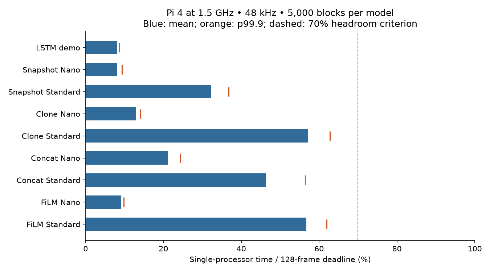
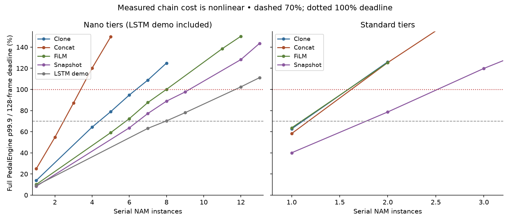
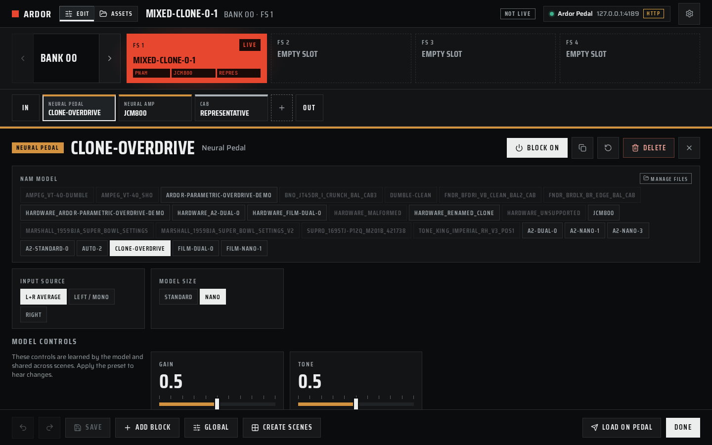

# Parametric NAM validation on Raspberry Pi 4 — 11–12 October 2026

## Result and practical capacity

Measurements on the user's Raspberry Pi 4 show that serial capacity depends strongly on architecture, model width and conditioning. A useful starting rig is **Clone Overdrive Nano → JCM800 Standard → 8,192-sample cabinet, at 48 kHz / 128 frames**. The eight-channel Standard parametric A2 models in the original capacity suite fit individually; two instances of those models exceed the processing deadline. Wider published tiers are measured separately below. Four CPU cores do not multiply the capacity of a serial chain: its dependent blocks run on one audio thread.

The table below qualifies homogeneous serial chains using **zero observed deadline misses and p99.9 processing time ≤70% of the block budget**, leaving nominal 30% headroom for other work. Each selected count was measured for 10,000 blocks, following 500 warm-up blocks. This is a conservative engineering criterion, not a product-enforced maximum or a guarantee of no future underruns. The final column is the largest tested count with zero misses in the shorter 3,000-block screening run; it has less headroom and is not the recommended limit.

| Model | 64-frame count | Mean / p99.9 budget | 128-frame count | Mean / p99.9 budget | Largest screened zero-miss count, 64 / 128 |
|---|---:|---:|---:|---:|---:|
| Open LSTM demo | 8 | 65.3% / 68.8% | 7 | 57.4% / 59.4% | 9 / 9 |
| Published Clone Overdrive Nano | 3 | 41.5% / 47.5% | 4 | 56.7% / 64.6% | 5 / 6 |
| Published Clone Overdrive Standard | 1 | 57.7% / 63.2% | 1 | 57.1% / 62.8% | 1 / 1 |
| Resident JCM800 A2 Nano | 6 | 56.5% / 69.9% | 6 | 56.6% / 64.8% | 7 / 8 |
| Resident JCM800 A2 Standard | 1 | 34.1% / 38.8% | 1 | 33.6% / 40.0% | 2 / 2 |
| Trainer FiLM A2 Nano | 5 | 50.6% / 62.8% | 5 | 51.4% / 59.4% | 6 / 7 |
| Trainer FiLM A2 Standard | 1 | 57.6% / 63.0% | 1 | 56.8% / 63.0% | 1 / 1 |
| Trainer concat A2 Nano | 2 | 48.4% / 56.8% | 2 | 44.4% / 54.5% | 3 / 3 |
| Trainer concat A2 Standard | 1 | 43.3% / 55.3% | 1 | 46.1% / 59.0% | 1 / 1 |

These counts measure DSP capacity through the engine benchmark. The normal manager serial-chain workflow permits one enabled amp; additional neural blocks are pedals. Repeating a snapshot amp in the homogeneous benchmark does not change that product rule.

The LSTM demo's 8-at-64 / 7-at-128 difference is a threshold effect in finite runs. Its screened eight-block 128-frame p99.9 was just above 70%; it does not establish that smaller periods inherently allow more blocks. Likewise, a zero-miss sample at a higher count does not prove that count is safe indefinitely. Additional effects, cabinet processing, parameter changes, UI work and other services consume the remaining headroom.

“Standard” and “Nano” describe tiers within a model, not a universal complexity. The trainer fixtures use eight/three channels; the published Clone uses eight/four. Concat controls increase conditioning channels, while FiLM modulates layer activations. Different weights, control counts, depth, heads, optimized kernels and exports can materially change capacity. These are not controlled experiments proving that FiLM is universally faster than concat. The five-block FiLM Nano offline qualification at 64 frames did not stay fault-free in the ten-minute live test; four blocks passed the separate 30-minute live test. The 24-control fixture and switch fixture were also tested, but should not inherit the two-control capacity numbers.

## Hardware and candidate

| Item | Observed configuration |
|---|---|
| Board | Raspberry Pi 4 Model B Rev 1.5, revision `a03115` |
| RAM | 927,620 KiB reported MemTotal, nominal 1 GB board |
| OS | Buildroot 2025.02.15, Linux 6.18.37-v8, AArch64, SMP PREEMPT |
| CPU | Performance governor, 1,500 MHz; no overclock introduced |
| Audio | Raspberry Pi Codec Zero, native 48 kHz, stereo S32_LE, MMAP_INTERLEAVED |
| Scheduling | Audio callback CPU 2, SCHED_FIFO/70; isolated compute benchmark CPU 2, SCHED_FIFO/60 |
| Screen | Framebuffer 720 × 1,280, RGB565 |
| Installed release | 0.1.54, commit `82bcdd361f2e4398559db477cc6fc3fccbd52b2d` |
| C++ candidate | Parametric feature `cead7c4c26a948aea3f1f62bd2e461965afa6cd9`, with benchmark and relocatable test-source additions |
| Manager candidate | `553fc236`, including root-confined metadata and zero-bank/slot command fix; freshly generated feature web bundle |
| Compiler | Buildroot GCC 13.4.0, Release, `-O2 -DNDEBUG`; no `-O3` or fast-math |

Dependencies were pinned to miniaudio 0.11.25 (`9634bedb5b5a2ca38c1ee7108a9358a4e233f14d`), stock NAM core `4c0ee78b71abd5eb20aec58562e7540f43caac3b`, and LVGL 9.5.0 (`85aa60d18b3d5e5588d7b247abf90198f07c8a63`). The parametric fork provenance is documented in [the feature notes](parametric-nam.md).

The overnight suite finished at 22:20 UTC. Its remote safety guardian restored the installed service at 02:07 UTC after the host completion process stopped during the session pause. The original Init rig then ran for almost three hours with zero fault counters before final validation resumed. A fresh 30-minute guardian protected the remaining model checks and final restoration.

The candidate ran from `/tmp/ardor-hw-20261011`, with a separate data root and a temporary manager on loopback port 18080. The installed firmware and production manager were preserved. Test output gain was −30 dB with a −1 dB safety limiter. An SSH tunnel exposed the temporary manager only on the host's loopback interface. Private user model weights were used locally on the Pi (a temporary in-root copy of JCM800 for preset-based tests) and were not copied into this report or repository. Binary checksums and complete compiler flags are retained in the evidence directory. Capacity and extended-soak measurements used the pre-listening C++ candidate; post-listening UI fixes `d7f286a7` and `3e853f71` are checked separately with the ARM regression smokes and final amp integration. The quiet-control checksum manifest identifies that later binary; the original benchmark checksum manifest is preserved.

The original 30-second baseline used the installed Init preset at 128 frames: 11,275 observed callbacks, 0.97 ms average callback time (36.3% of budget), 1.41 ms lifetime maximum, zero sampled overruns/gaps/DSP faults, CPU 2 busy 34.6%, and audio thread FIFO/70 with no migrations. It was not an empty-chain baseline, and no kernel XRUN trace was active for that baseline.

## Test method and interpretation

At 48 kHz, block deadlines are 0.667 ms for 32 frames, 1.333 ms for 64, and 2.667 ms for 128. Percentage values in the benchmark tables mean **processing time divided by this one-thread deadline**. They are not whole-machine CPU percentages. A 60% block consumes about 60% of one callback's compute budget, not 60% of all four cores.

Four complementary methods were used:

1. ARM-native correctness tests compare inference outputs with Python and independent C++ references, check malformed inputs and exercise UI/preset/routing contracts.
2. Single-processor microbenchmarks cover 20 model files / 34 model–tier combinations at 32, 64 and 128 frames: 102 cases × 5,000 blocks = 510,000 measured blocks, after warm-up, with zero measured deadline misses.
3. Full serial `PedalEngine` benchmarks include NAM boundaries, mono/stereo copies, gain smoothing, sanitization and the safety limiter. Screening measured 240,000 blocks, qualification 180,000, and mixed chains 210,000. Total offline measured blocks: **1,140,000**. All produced finite outputs. Some deliberately oversized chains missed deadlines; those failures locate capacity boundaries.
4. Wall-clock duplex Codec Zero runs observe callback telemetry, native ALSA parameters, thread scheduling, memory and thermal behavior. Kernel tracing records calls to `__snd_pcm_xrun`, separately from Ardor's callback counters. A deliberately overloaded chain serves as the trace detector's positive control.

Offline input alternates silence, quiet and louder deterministic harmonic/noise blocks. Input generation and result inspection are outside the timed DSP section. These accelerated runs measure compute capacity, not continuous hardware playback. Load time and RSS are recorded separately. p99.9 is an empirical quantile of a finite sample; “zero observed” describes the sample only. Individual maxima and all miss counts are retained in CSV. RSS is whole-process resident memory and may retain allocations across benchmark cases; it should not be interpreted as an exact per-block memory cost.

Kernel XRUN tracing was restricted to a private tracefs instance filtered to `__snd_pcm_xrun`. This function transitions ALSA PCM to XRUN in the tested kernel. Trace buffer statistics were collected to check for dropped events. Callback gaps measure an interval greater than 1.5 times the client block interval; they are not identical to ALSA underruns, especially when backend periods differ from client periods.

## Correctness and model format coverage

The Pi passed the parametric inference smoke, trainer compatibility smoke, LVGL UI smoke, WDW routing builder, preset preview/reload stress, and ARM manager asset/preset tests. The initial WDW invocation lacked its example-model fixture and the initial preset test deployment lacked one JSON fixture; both were rerun with those fixtures and passed. Initial failures remain in the raw evidence rather than being discarded. The first amp soak was also aborted because an external symlink correctly failed the preset data-root check; its fallback and failed restart attempt are excluded from qualification. An initial five-FiLM run changed to an empty slot while the user was operating the Pi’s controls (confirmed by the user); that interrupted run is excluded. A subsequent launch with a nonexistent control-device path failed immediately and was excluded; `/dev/null` supplies a valid, event-free input for the repeated static soaks. Subsequent static soaks disabled those inputs for the benchmark process and checked that active-preset state remained unchanged. The JCM800 fixture was then copied into the temporary Pi data root, and the actual active preset was verified before the complete soak runs. Other resident-model symlinks were used only by direct processor benchmarks; their metadata through the isolated manager is intentionally unsupported because their targets lie outside its confined directory.

Trainer compatibility produced **102 Python/C++ comparisons**, with maximum absolute error **2.05636 × 10⁻⁶**. Coverage includes concat Standard/Nano, combined one-file A2 exports, continuous controls, one-hot switches, the 24-control contract, FiLM Standard/Nano and physical-range normalization. The published Clone's two tiers were checked against Gene Ko's independent generic Eigen implementation. The open LSTM demo's Drive/Tone changes, switch encoding, reset and block-size independence were also checked.

The 600-edit preview stress test reported total p95 0.176555 ms and maximum 0.234852 ms for its synthetic fixture. This is not a claim that loading arbitrary neural weights takes less than a millisecond; real model preparation/apply timings are measured separately.

The trainer fixtures are small deterministic training/export fixtures, including deliberately brief synthetic training. Their successful inference establishes format compatibility and numerical agreement, not capture fidelity or good amplifier tone. The bundled open overdrive demo is clearly identified as a synthetic DSP-trained demo. HyperWaveNet, FiLM schema 2/LoRA/residual heads and unsupported arbitrary fork formats remain outside this implementation.

## Public parametric amp sources

The actual published model collection is [Gene Ko’s NAMix v0.6.6 release](https://github.com/mrgeneko/NAMix/releases/tag/v0.6.6). Four files identify themselves as amps:

| Released amp | Learned controls | Exported channel widths |
|---|---|---|
| British 800 Preamp | Gain | 4 / 8 |
| Cali Duo Reverb 85 Watt | Volume | 4 / 5 / 8 / 9 |
| Special Bundle Overdrive 183 — Rock channel | Volume, Master Volume | 4 / 8 |
| Special Bundle Overdrive 183 — Jazz channel | Volume, Master Volume | 4 / 8 |

The same release has eight parametric pedal files. All twelve files were downloaded directly from their release assets and passed an additional **host format/load smoke across all 27 exported tiers**, processing 50 blocks per tier with finite sampled checksums. This is an x86_64 compatibility check, excluded from Pi performance totals; it does not qualify those public amps’ Pi capacity, every output sample, capture fidelity, or analog tone. `public-model-catalog.json` records original URLs, checksums, gear metadata, schemas and controls; no downloaded weights are included in the evidence. The model files use FiLM schema 1 and skip heads. Width varies by model; “Nano” is not universally three channels.

For PC auditioning, the same release provides NAMix standalone and VST3 builds for Windows, Linux and macOS. Its model picker exposes the model’s learned controls. In the Pi listening session, **only the overdrive was parametric**: the published Clone Nano fed the user’s existing Supro snapshot amp. The JCM800 and Supro resident models are fixed-control A2 snapshots, while the trainer’s FiLM amp fixture is synthetic. These should not be presented as downloaded parametric amp captures.

## Single-model results

See `model-sweep.csv` for every model/tier/period and `model-summary.txt` for the full distribution. Representative 128-frame single-processor measurements:

| Model | Mean budget | p99.9 budget |
|---|---:|---:|
| Open LSTM demo | 8.0% | 8.7% |
| Resident JCM800 Nano | 8.1% | 9.4% |
| Resident JCM800 Standard | 32.3% | 36.8% |
| Two-control concat A2 Nano | 21.1% | 24.4% |
| Two-control concat A2 Standard | 46.4% | 56.4% |
| Published Clone Nano | 12.9% | 14.1% |
| Published Clone Standard | 57.2% | 62.8% |
| Trainer FiLM Nano | 9.0% | 9.8% |
| Trainer FiLM Standard | 56.7% | 62.0% |



These values omit some complete-engine costs. The whole-chain measurements above supersede estimates made by dividing 100% by a single-model average. Cost increased nonlinearly as repeated models were added. For example, two concat Standard blocks consumed approximately 107–110% on average and missed every screened deadline, despite one block's average being below 50%.



## Pedal plus amp and cabinet

Each row includes the stated number of repeated pedal instances, one resident **JCM800 Standard** snapshot amp and one 8,192-sample mono cabinet impulse. The NAM count includes the amp. Cabinet convolution is included in the timing. The synthetic impulse is a reproducible workload, not a listening-quality cabinet capture.

| Pedal model / tier | Pedals + amp = NAM count | 64-frame mean / p99.9 | Misses / 5,000 | 128-frame mean / p99.9 | Misses / 5,000 |
|---|---:|---:|---:|---:|---:|
| Open LSTM demo | 2 | 47.8% / 58.1% | 0 | 44.9% / 52.4% | 0 |
| Open LSTM demo | 3 | 56.2% / 65.9% | 0 | 52.8% / 60.2% | 0 |
| Open LSTM demo | 4 | 64.2% / 73.9% | 0 | 61.0% / 68.1% | 0 |
| Published Clone Overdrive Nano | 2 | 55.6% / 64.8% | 0 | 54.4% / 61.9% | 0 |
| Published Clone Overdrive Nano | 3 | 72.3% / 85.0% | 0 | 69.6% / 78.9% | 0 |
| Published Clone Overdrive Nano | 4 | 89.9% / 103.8% | 14 | 88.2% / 95.1% | 0 |
| Published Clone Overdrive Standard | 2 | 102.9% / 116.1% | 5000 | 100.0% / 107.9% | 2020 |
| Published Clone Overdrive Standard | 3 | 169.8% / 186.9% | 5000 | 162.9% / 171.3% | 5000 |
| Published Clone Overdrive Standard | 4 | 236.4% / 254.4% | 5000 | 223.4% / 232.0% | 5000 |
| Trainer FiLM A2 Nano | 2 | 50.1% / 58.8% | 0 | 48.0% / 55.9% | 0 |
| Trainer FiLM A2 Nano | 3 | 63.8% / 76.8% | 0 | 60.2% / 67.3% | 0 |
| Trainer FiLM A2 Nano | 4 | 75.2% / 91.3% | 1 | 72.0% / 79.4% | 0 |
| Trainer FiLM A2 Standard | 2 | 102.0% / 115.9% | 4822 | 99.0% / 108.5% | 589 |
| Trainer FiLM A2 Standard | 3 | 168.8% / 183.3% | 5000 | 162.0% / 169.9% | 5000 |
| Trainer FiLM A2 Standard | 4 | 234.5% / 248.7% | 5000 | 224.0% / 232.4% | 5000 |
| Trainer concat A2 Nano | 2 | 67.4% / 80.1% | 0 | 64.0% / 71.7% | 0 |
| Trainer concat A2 Nano | 3 | 98.4% / 111.5% | 977 | 94.0% / 103.2% | 47 |
| Trainer concat A2 Nano | 4 | 130.6% / 149.1% | 5000 | 122.4% / 133.1% | 5000 |
| Trainer concat A2 Standard | 2 | 95.6% / 112.5% | 497 | 95.3% / 104.9% | 152 |
| Trainer concat A2 Standard | 3 | 160.5% / 184.0% | 5000 | 150.2% / 163.2% | 5000 |
| Trainer concat A2 Standard | 4 | 219.3% / 248.3% | 5000 | 204.8% / 222.2% | 5000 |

A single Clone Nano pedal plus Standard amp and cab passes the 70% p99.9 criterion at both 64 and 128 frames. Two FiLM Nano pedals plus that amp and cab pass it at 128 frames (67.3% p99.9); the equivalent 64-frame case reaches 76.8%. Concat Nano plus the amp/cab has zero observed misses but reaches 80.1% / 71.7% p99.9, so it does not meet the conservative margin. A Standard parametric pedal plus this Standard amp is at or beyond the deadline; it should not be presented as a reliable serial rig on this board.

## Live audio, manager and stability results

The duration column below shows the requested minimum probe window. Sampling overhead makes actual wall time slightly longer; thread CPU percentages use measured `/proc/uptime` elapsed time.

The `extended-wdw-four` case has two complete branches, each containing Clone Nano → JCM800 Standard → an 8,192-sample cabinet: four NAM instances and two cabinet instances in total. Dry and wet branch workers request CPUs 0 and 1, while the audio callback requests CPU 2. This tests parallel branch execution; its result should not be treated as four serial Standard blocks fitting on one thread. The per-case scheduling records and CPU probe identify the actual worker configuration.

| Live case | Frames | Duration | Lifetime callbacks | Mean / maximum | Processing overruns / gaps | Worker over / underflow / submit miss | Kernel XRUNs | Nonfinite / mismatch / bypass | Performance check |
|---|---:|---:|---:|---:|---:|---:|---:|---:|---|
| soak-clone-amp-cab-final | 128 | 600 s | 228438 | 1.45ms / 2.27ms | 0 / 0 | 0 / 0 / 0 | 0 | 0 / 0 / 0 | PASS |
| soak-film-five-isolated-final | 64 | 600 s | 459092 | 0.70ms / 1.59ms | 5 / 0 | 0 / 0 / 0 | 0 | 0 / 0 / 0 | FAIL |
| extended-clone-amp-cab | 128 | 3600 s | 1363446 | 1.46ms / 2.51ms | 0 / 0 | 0 / 0 / 0 | 0 | 0 / 0 / 0 | PASS |
| extended-film-four | 64 | 1800 s | 1367080 | 0.56ms / 1.29ms | 0 / 0 | 0 / 0 / 0 | 0 | 0 / 0 / 0 | PASS |
| extended-wdw-four | 128 | 1800 s | 686145 | 0.03ms / 0.15ms | 0 / 0 | 0 / 11 / 0 | 0 | 0 / 0 / 0 | FAIL |
| extended-snapshot-two | 128 | 600 s | 228411 | 1.94ms / 2.54ms | 0 / 0 | 0 / 0 / 0 | 0 | 0 / 0 / 0 | PASS |
| amp-manager-integration-final | 128 | 90 s | 35173 | 0.18ms / 0.46ms | 0 / 0 | 0 / 0 / 0 | 0 | 0 / 0 / 0 | PASS |
| public-amp-manager-integration-final | 128 | 90 s | 35243 | 0.38ms / 1.82ms | 0 / 0 | 0 / 0 / 0 | 0 | 0 / 0 / 0 | PASS |

Durations are requested minimum probe windows; polling overhead slightly extends actual elapsed time, which the CPU probe measures independently. Lifetime counters also include startup and settling. Five FiLM Nano blocks at 64 frames had five processing overruns in ten minutes, despite zero kernel XRUNs and no bypass. Its offline five-block result is a compute qualification only; it is not a zero-fault live recommendation. Consult the four-block extended run above for the more conservative live result. The two-snapshot case is a boundary experiment, not an endorsement of two enabled amps in the normal serial manager workflow.

| Extended case | Audio thread CPU | Branch worker CPU | Total process CPU |
|---|---:|---:|---:|
| extended-clone-amp-cab | 57.2% | — | 59.7% |
| extended-film-four | 44.6% | — | 46.9% |
| extended-wdw-four | 4.2% | 60.0% + 59.3% | 126.4% |
| extended-snapshot-two | 75.1% | — | 77.6% |

These percentages use one core as 100%; a process total above 100% reflects multiple cores. The WDW branch workers actually ran FIFO/69 on CPUs 0 and 1, with no migrations; the audio thread ran FIFO/70 on CPU 2. Its 0.03 ms callback average covers submission and mixing while neural inference runs on the workers. It is not a measure of the four models’ total DSP cost. The nine additional worker underflows during the probe mean that this configuration failed the corrected stability criterion.

The two final amp-integration averages span the initial empty chain and subsequent model/control/tier applies; they are not steady-state single-model benchmarks.

The real manager API recorded 269 observations, including four supported-format uploads, duplicate handling, malformed/unsupported assets, saved controls, rename propagation, 40 alternating control/tier applications, and rejection without changing the active preset. Forty-two successful applies measured 123.7 ms minimum, 195.6 ms median, 245.7 ms p95 and 916.9 ms maximum. Eight desktop/phone browser workflows used the real Pi API without mocks; two additional workflows verified amp classification and the one-enabled-amp constraint. The standalone FiLM amp import and final runtime apply are retained separately.

The deliberately overloaded two-FiLM-Standard positive control recorded three kernel XRUNs, 33 processing overruns and latched bypass. Its very low CPU usage after bypass is not a healthy capacity result. Fresh Clone Nano recovery passed with zero faults. Native default-device empty and concat Standard runs at 32/64/128 frames passed; the initial indexed-device burst case is excluded as described below. Trace-buffer statistics are retained per case.

Across 7352 five-second thermal observations, sampled temperature ranged from 46.3 to 65.7 °C, CPU clock from 1500 to 1500 MHz, and undervoltage alarms totaled 0. The thermal logger continued through the idle period after the overnight suite, until manual completion resumed. Per-case thermal ranges in the probes identify the actual loaded runs. These counters do not independently establish every possible firmware throttle reason. Each live case retains start/final RSS and thread scheduling records. The faster one-second WDW probe recorded the session’s highest observed temperature, 66.2 °C; its sampled clock remained at 1,500 MHz.

- `extended-clone-amp-cab` process RSS: 28068 → 28068 KiB.
- `extended-film-four` process RSS: 29836 → 29836 KiB.
- `extended-wdw-four` process RSS: 46112 → 46112 KiB.
- `extended-snapshot-two` process RSS: 27532 → 27532 KiB.

Thirty-second resource samples supplement the endpoint RSS checks. Sampling started partway through the first extended run.

| Extended case | Resource samples | RSS range (KiB) | Temperature range (°C) | CPU clock range (MHz) | Undervoltage samples |
|---|---:|---:|---:|---:|---:|
| extended-clone-amp-cab | 94 | 28068–28068 | 55.5–59.4 | 1500–1500 | 0 |
| extended-film-four | 60 | 29836–29836 | 54.0–57.0 | 1500–1500 | 0 |
| extended-wdw-four | 62 | 40784–46112 | 54.5–65.2 | 1500–1500 | 0 |
| extended-snapshot-two | 20 | 27532–27532 | 58.9–60.9 | 1500–1500 | 0 |

The WDW sampler captured allocations before the settled start snapshot (40,784 → 46,112 KiB); the start and final snapshots were both 46,112 KiB. Serial extended-run RSS remained constant across all samples. This does not rule out leaks under unrelated usage or indefinite operation.

The separate listening session is described under limitations; subjective feedback was positive. The post-listening UI-only quiet-preview build was checked separately on ARM and does not change these DSP workloads.

### Published NAMix models on ARM

All twelve released files were additionally loaded on this Pi across all 27 tiers, at 64 and 128 frames: 54 cases × 3,000 measured blocks, following 300 warm-up blocks. All sampled checksums were finite, and all 54 cases had zero observed deadline misses. This adds 162,000 measured blocks to the earlier 1,140,000-block suite. These are single-processor measurements with default learned controls, not full-chain capacity or a guarantee across the entire control range. Every case, including deadline misses, is retained in `public-model-arm-sweep.csv`.

| Published amp / tier | 64-frame mean / p99.9 budget | Misses / 3,000 | 128-frame mean / p99.9 budget | Misses / 3,000 |
|---|---:|---:|---:|---:|
| british-800-preamp / nano | 13.5% / 16.0% | 0 | 12.9% / 14.7% | 0 |
| british-800-preamp / full | 58.5% / 62.9% | 0 | 57.4% / 63.6% | 0 |
| cali-duo-reverb-85watt / tier-0 | 13.6% / 15.9% | 0 | 13.1% / 14.7% | 0 |
| cali-duo-reverb-85watt / tier-1 | 20.8% / 23.2% | 0 | 20.4% / 22.2% | 0 |
| cali-duo-reverb-85watt / tier-2 | 58.1% / 63.3% | 0 | 57.5% / 63.0% | 0 |
| cali-duo-reverb-85watt / tier-3 | 75.1% / 82.1% | 0 | 74.8% / 81.3% | 0 |
| special-bundle-overdrive-183-jazz-channel / nano | 13.4% / 14.4% | 0 | 12.9% / 14.8% | 0 |
| special-bundle-overdrive-183-jazz-channel / full | 58.0% / 63.2% | 0 | 57.5% / 62.8% | 0 |
| special-bundle-overdrive-183-rock-channel / nano | 13.5% / 14.2% | 0 | 13.0% / 14.2% | 0 |
| special-bundle-overdrive-183-rock-channel / full | 57.8% / 62.9% | 0 | 57.2% / 63.5% | 0 |

The published British 800 Preamp also passed real manager upload, amp classification, save/readback, and four acknowledged runtime applies covering minimum/maximum Gain and Nano/Standard tiers. Its 90-second duplex run appears above. Output remained muted; no listening claim is made for this amp. This test imports into the temporary manager only and does not bundle the model.




The [phone capture](../benchmark-results/parametric-nam-pi4-20261011/live-rig-phone.png) shows the same learned controls and Nano selection. The [native framebuffer capture](../benchmark-results/parametric-nam-pi4-20261011/native-ui-live-rig.png) records actual device rendering.

## Findings and changes made during validation

- The 30-minute WDW run accumulated 11 worker underflows (two before the probe and nine during it), while callback overruns, gaps, submission misses and traced ALSA XRUNs remained zero. The original performance probe omitted worker-underflow and submission-miss counters and incorrectly labeled that run PASS. The probe now checks their deltas, detects counter resets and has six regression cases in CI. Raw original results are retained; the report corrects the classification to FAIL. This WDW configuration is not qualified for zero-fault use.
- The user listening session exposed a distracting success toast on every learned-control change. Parameter previews now complete silently; failed updates still show errors and roll back. Host inference/UI-model and LVGL smoke checks passed. This UI-only change was made after the capacity measurements, so the existing timing results apply to the pre-toast-fix binary.
- Native control-path verification found that the pedal Standard/Nano selector was displayed but rejected by an amp-only setter. The setter now accepts neural pedals too; the native edit path switches tiers, preserves learned values, and queues the new audio chain without a success toast. Host and ARM regression outcomes are retained with the final quiet-control checks.
- Real manager/device testing exposed a pre-existing protocol mismatch: Go omitted zero-valued bank/slot fields, while C++ rejected missing fields. Apply requests to bank 0 or slot 0 remained pending. The command serializer now retains both coordinates; host and ARM regression tests cover (0,0), (0,3) and (98,0), and the real browser/device workflows were rerun successfully.
- Final CI review made the existing rename filename boundaries explicit for both path separators, and rejects a sanitized name containing `..` consistently with the existing Rename/Delete ID contract. Host asset/server tests and the full ARM asset test binary passed, including invalid IDs and an unchanged-original check. This guard was added after the live manager measurements; valid tested asset names and inference are unaffected.
- NAM metadata reads now use a directory-confined reader. Malformed JSON is retained as an unsupported asset with a useful error, allowing the manager to show it without inventing playable controls.
- The device manager's generated embedded web bundle was rebuilt to include the feature. Testing source-only UI builds would not have verified what the Go daemon actually serves.
- Hardware test sources accept CMake fixture-path settings so ARM binaries can be deployed independently of their build-machine path. An initial environment-based override triggered CodeQL path-injection alerts in test-only readers; the final configuration embeds the fixture paths at build time instead.
- Selecting Codec Zero by enumerated index 1 opened native 1,024-frame periods with a 16,384-frame buffer in the initial test. Ardor's 32/64/128 client blocks then ran in bursts, causing periodic gap counters even with an empty chain. The same default-device selection (`-1`) used by the installed firmware opened the requested native 32/64/128-frame periods with three-period buffers. The live qualification uses that verified configuration. This is a device/backend configuration finding, not evidence that the empty DSP chain overruns. Check actual ALSA parameters whenever changing interface selection.

## Limits of the validation

Performance measurements kept the hardware output relay and headphone playback muted. A separate user listening session enabled the relay and headphone playback, using four physical footswitch presets: Supro snapshot baseline, Clone Nano low gain, high gain, and high gain with brighter tone. The user reported clear gain and tone changes with no clicks or dropouts. Listening telemetry recorded 50,774 callbacks, zero processing overruns/gaps/DSP faults and zero traced ALSA XRUNs; maximum callback time was 2.24 ms against a 2.667 ms deadline. Output gain was −12 dB for listening and the user adjusted headphone level at their external interface. This is subjective functional validation, not a calibrated audio-quality measurement. The user confirmed that the audio interface is connected, with headphones/powered monitors receiving the output and no physical output-to-input loopback. No calibrated external analyzer was available. Native buffer sizes and scheduling were measured; **analog round-trip latency, converter noise and frequency response were not measured**. The 0.667/1.333/2.667 ms deadlines are compute windows, not analog round-trip figures. Startup, device buffering, codec delay and any DSP latency add to end-to-end latency.

The tests establish behavior on this Pi, at this clock, OS and audio interface, for these weights and controls. They do not establish limits for other Pis, other rates, USB interfaces or arbitrary user captures. Native UI rendering is tested; physical touchscreen gestures, MIDI and expression-pedal operation were not formally tested. A user-operated footswitch change was observed, but the complete physical-control matrix was not qualified. Network stress, power interruption and reboot recovery were not part of this session. Extended thermal and memory observations accompany the live results above.

## Reproduction and evidence

Raw evidence is in [the benchmark directory](../benchmark-results/parametric-nam-pi4-20261011/). CSV files retain mean, p50, p99, p99.9, maximum, miss count, loading time, RSS, peak and non-finite counts. The command files preserve every selected benchmark case. No credentials or private model weights are included.

Build the ARM targets with the production Buildroot toolchain in Release mode: `pedal-nam-bench`, `pedal-nam-chain-bench`, `pedal-parametric-nam-smoke`, `pedal-parametric-trainer-compat-smoke`, `pedal-lvgl-ui-smoke`, `pedal-wdw-routing-builder-smoke` and `pedal-preset-reload-stress`. Configure `-DARDOR_PARAMETRIC_TEST_SOURCE_DIR=/path/to/deployed/fixtures` and `-DARDOR_PARAMETRIC_TEST_EXAMPLE_MODEL=/path/to/deployed/example-lstm.nam` at build time where needed.

Example full-engine serial benchmark:

```sh
chrt -f 60 pedal-nam-chain-bench --cpu 2 --block-sizes 64,128 \
  --counts 1,2,3,4,5,6,7,8 --iterations 10000 --warmup 500 \
  --tier 0 film-dual-0.nam
```

Example mixed rig:

```sh
chrt -f 60 pedal-nam-chain-bench --cpu 2 --block-sizes 64,128 \
  --counts 1,2,3 --iterations 5000 --warmup 500 --tier 0 \
  --amp JCM800.nam --amp-tier 1 --cab clone-overdrive.nam
```

Run [the manager API validation script](../scripts/validate-parametric-device.py) only against an isolated test manager and data root; it uploads test assets and writes bank 98. Its `--runtime` mode requires the matching audio process to be running. Live test shell scripts and browser observations are retained with the evidence.

## Restoration

The installed service was restarted with the original Init preset at bank 0 / slot 0, 48 kHz / 128 frames. All saved preset/settings hashes and the installed pedal executable matched their pre-test values. The production manager retained PID 400. Temporary audio/manager processes and tracing were stopped, the SSH forwarding was canceled, and the restored production audio passed a 30-second performance probe. See `restoration.log`, `restoration-performance.txt`, `guardian-extended.log` and `guardian-recovery.log` in the evidence directory.
